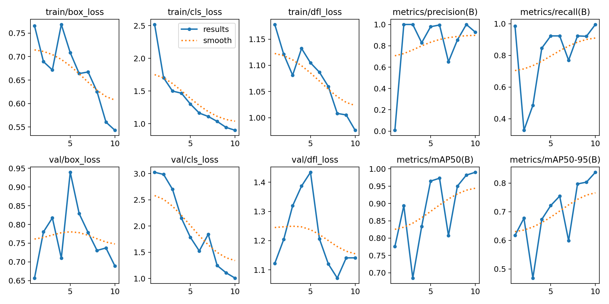
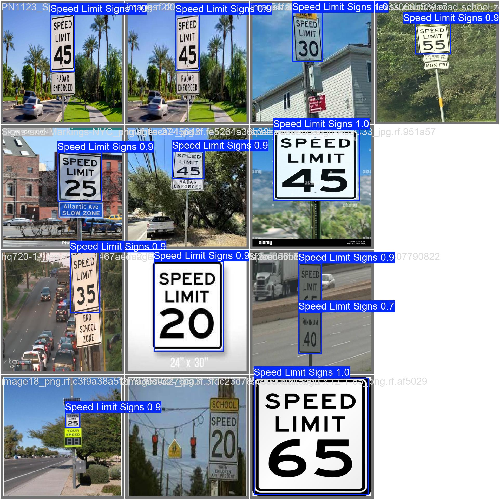

# MLJupyter

Notebook-first computer vision project for training and testing a YOLOv8 speed limit sign detector, with one archived stop-sign mapping prototype preserved for context.

## Project Overview

`MLJupyter` is a personal machine learning experiment centered on traffic-sign detection. The mainline workflow trains a single-class YOLOv8 model against a Roboflow-exported speed limit sign dataset and then runs the resulting detector against a webcam feed.

This repository is not an external fork. It is a personal project that was originally developed as exploratory notebooks and has been cleaned into a portfolio-ready structure.

## Current Status

- Status: Portfolio-ready experiment
- Verdict: `DONE` for archiving and showcase purposes, not active research
- Focus: Speed limit sign detection with an archived stop-sign/GPS prototype

## Key Features

- Local YOLOv8 training notebook with no hardcoded API keys
- Bundled traffic-sign dataset for reproducible experimentation
- Curated trained weight file in [`models/speed_limit_detector_best.pt`](/Users/zchal/CODING/MLJupyter/models/speed_limit_detector_best.pt)
- Webcam inference notebook for live demo usage
- Archived stop-sign mapping prototype in [`archive/prototype_stop_sign_mapping.ipynb`](/Users/zchal/CODING/MLJupyter/archive/prototype_stop_sign_mapping.ipynb)
- Training result artifacts captured in [`docs/training_results.png`](/Users/zchal/CODING/MLJupyter/docs/training_results.png) and [`docs/confusion_matrix.png`](/Users/zchal/CODING/MLJupyter/docs/confusion_matrix.png)

## Results Snapshot

The best preserved training run reached:

- Precision: `0.92824`
- Recall: `0.99531`
- mAP@50: `0.99`
- mAP@50-95: `0.83774`

Training outputs used for this summary are preserved as lightweight documentation assets rather than a full `runs/` directory dump.





## Technical Stack

- Language: Python 3
- Notebooks: Jupyter Notebook / JupyterLab
- Model framework: Ultralytics YOLOv8
- Deep learning runtime: PyTorch
- Computer vision: OpenCV
- Dataset source: Roboflow export in YOLOv8 format
- Optional prototype tooling: Folium, Tesseract OCR

## Installation

### Option 1: Use the captured Conda environment

```bash
conda env create -f environment.yml
conda activate Sandbox
```

### Option 2: Use a lighter pip environment

```bash
python -m venv .venv
.venv\Scripts\activate
pip install -r requirements.txt
```

## Usage

### 1. Train the detector

Open [`notebooks/01_train_speed_limit_detector.ipynb`](/Users/zchal/CODING/MLJupyter/notebooks/01_train_speed_limit_detector.ipynb) and run the notebook from top to bottom.

The notebook:

- Resolves the local dataset under `data/speed_limit_signs_v1/`
- Starts from `yolov8n.pt`
- Trains a single-class detector
- Optionally runs a small prediction preview against test images

### 2. Run the webcam demo

Open [`notebooks/02_webcam_speed_limit_demo.ipynb`](/Users/zchal/CODING/MLJupyter/notebooks/02_webcam_speed_limit_demo.ipynb).

The notebook expects the curated weight file at `models/speed_limit_detector_best.pt` and runs live inference until you press `q`.

### 3. Review the archived prototype

Open [`archive/prototype_stop_sign_mapping.ipynb`](/Users/zchal/CODING/MLJupyter/archive/prototype_stop_sign_mapping.ipynb) only if you want the original stop-sign mapping concept. It is intentionally archived because it depends on external YOLOv3 files and simulated GPS logic rather than the cleaned YOLOv8 pipeline.

## Project Structure

```text
MLJupyter/
|-- archive/
|   `-- prototype_stop_sign_mapping.ipynb
|-- data/
|   `-- speed_limit_signs_v1/
|       |-- data.yaml
|       |-- README.dataset.txt
|       |-- README.roboflow.txt
|       |-- train/
|       |-- valid/
|       `-- test/
|-- docs/
|   |-- confusion_matrix.png
|   |-- training_results.png
|   `-- validation_prediction.jpg
|-- models/
|   `-- speed_limit_detector_best.pt
|-- notebooks/
|   |-- 01_train_speed_limit_detector.ipynb
|   `-- 02_webcam_speed_limit_demo.ipynb
|-- .gitignore
|-- environment.yml
`-- requirements.txt
```

## Dataset Notes

- Dataset name in source export: `SandBox - v1`
- Dataset size: `266` images
- Annotation format: YOLOv8
- License: `CC BY 4.0`
- Source metadata is preserved in [`data/speed_limit_signs_v1/README.dataset.txt`](/Users/zchal/CODING/MLJupyter/data/speed_limit_signs_v1/README.dataset.txt) and [`data/speed_limit_signs_v1/README.roboflow.txt`](/Users/zchal/CODING/MLJupyter/data/speed_limit_signs_v1/README.roboflow.txt)

## Notes

- The repository intentionally excludes generated `runs/` output and notebook checkpoints.
- The original hardcoded Roboflow API key was removed from the published workflow.
- The archived stop-sign notebook is kept because it represents the more product-oriented idea you were building, even though the speed-limit detector is the cleaner reproducible artifact.
